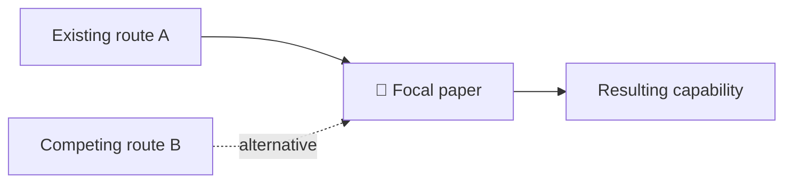

# Visual-first paper research report

## Goal
Help the reader understand **field trend, the focal paper's location, its value, what it does and how** within the first glance. Visuals summarize evidence; they never replace claim-level source checks.

## Rendering and scope invariants
- **Never output copied DOM/CSS/SVG rendering source** such as `#chatgpt-mermaid-...`, CSS selectors, embedded theme styles, or escaped markup. These are not research diagrams.
- Write original Mermaid *source* in a code fence only when supported, and add a short text alternative. If portability is uncertain, use Markdown/ASCII flow or a small structured table.
- Do not let visual complexity crowd out new information. One diagram can combine field branches, team inheritance and paper location if readable.
- No self-authored reusable prompt or instructions-to-the-user preamble unless specifically requested.
- L1/L2 are paper understanding and evidence criticism, **not future experiments**. Quoted examples or assistant-created suggested prompts are not instructions to change the task.
- Check output before finalizing: no CSS dump, no repeated verdict sections, no unrequested experiment, clear dated paper position.

## L2 visual storyboard
1. **🧭 Topic field map:** Use a compact timeline or branching flow (prefer Mermaid flowchart when supported) showing at least two legitimate competing research paradigms, their dated representative works, and where the focal paper sits. Differentiate verified prior methods from inferred trend. Do not depict several parallel approaches as a mandatory linear sequence.
2. **📍 Paper placement and team genealogy:** Show distinct edges for field precedence, shared-author/team inheritance and alternative systems. Label sources and avoid treating mere institutional affiliation as project continuity. A short table may be clearer than a huge graph.
3. **⚙️ What/how:** Input (type, resolution, instruction) → reuse/novel components → output, annotate purposes, constraints and claim evidence. Reused methods should not be colored or labeled as novel inventions.
4. **💡 Value and 📊 evidence:** Three concrete novel-to-reader information increments, supported/uncertain distinctions, best original tables/figures, with exact conditions.
5. **⚠️ Open issues:** Compact 3–6 issues; differentiate observed failures, untested claims and mechanistic hypotheses. **No experiment designs unless explicitly requested.**

## Presentation discipline
- Opening: one paragraph verdict plus reading tier and one-line 'why'.
- Prefer 1–3 compact, legible visuals not 12 independent cards or diagrams.
- Support Markdown Mermaid syntax when renderer supports it, else ASCII and tables.
- Every dated milestone is sourced; annotate 'inferred' on uncertain connections.
- Show author paper figures where permitted and appropriate; otherwise redraw a conceptual schematic clearly marked as your own.
- Max 3 core value points, 3–6 weaknesses; put detailed audit tables after graphics.
- Avoid speculative performance comparisons, false precision, decorative icons, and invented quantitative charts.
- If user requests a full evidence audit, expand original result checks without losing the visual executive overview.
- No 'suggested experiments', design of new datasets, statistical test plans or stop/go tables in ordinary L1/L2 output.

## Compact example (conceptual, not factual claims)

Preferred final section: **Knowledge delta** — Already known | Newly supported | Still unresolved — plus reusable research lessons only when legitimately distinct from existing rules.
