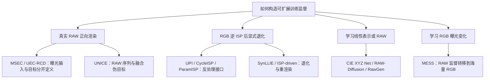

# 成像训练数据合成：逆 ISP、RAW 生成与曝光退化

版本：v0.1｜更新：2026-10-23｜主主题：T05；连接 T01、T02、T03、T04

目录：[一分钟回忆](#一分钟回忆) · [问题与范围](#问题与范围) · [路线地图](#路线地图) · [历史工作矩阵](#历史工作矩阵) · [MESS与RawGen](#mess与rawgen) · [系统方案回忆](#系统方案回忆) · [证据与瓶颈](#证据与瓶颈) · [最小判别实验](#最小判别实验) · [维护与核验](#维护与核验) · [References](#references)

> 本页是持续维护的专题 survey，首版纳入 13 项代表工作；不是穷尽检索或独立复现。以问题和机制组织前序，不把新旧论文排成单一进步链。单篇细节保存在唯一论文卡片；本页维护路线关系、比较、系统认识和判断变化。

## 一分钟回忆

**共同问题：真实配对训练数据难以规模化，怎样利用已有 RAW、RGB 和生成先验，构造对真实相机有效的监督？**

记住三个问题，就能恢复这张地图：**什么是可信来源？在哪个域生成或退化？什么是最终训练目标？**

| 路线 | 记忆锚点 | 保留的优势 | 必须支付的代价 |
|---|---|---|---|
| 真实 RAW 正向渲染 | MSEC、UEC/RCD | 源数据有线性观测基础，曝光与部分 ISP 变量可以受控 | RAW 场景规模受限；目标还可能包含人工风格 |
| RGB 逆 ISP，再显式造退化 | Unprocessing、CycleISP、ParamISP | 可用大规模 RGB；噪声、曝光、WB 等变量可单独控制 | 逆 ISP 不唯一，未知处理与信息丢失带来错配 |
| 学习线性表示/RAW 生成 | CIE XYZ Net、RAW-Diffusion、RawGen | 学习复杂逆映射；RAW/XYZ 可服务多个下游任务 | 对训练域、相机标定或适配有要求；生成细节不等于真实观测 |
| RAW 监督迁移到 RGB 曝光合成 | UNICE → MESS 的相关问题脉络 | 将曝光先验用于更大场景覆盖；MESS 保留原始高质 RGB 作为目标 | 生成的输入可能结构漂移；目标“高质”仍需筛选和定义 |

最后一行是**有引用和作者重叠支持的研究脉络**，不表示两个系统目标相同。UNICE 在增强时生成 MES 再融合；MESS 将生成器放在离线数据生产阶段，部署时可以只保留下游学生。

## 问题与范围

数据稀缺至少有四个来源：真实场景不够多、同场景退化覆盖不足、高质量目标定义困难、精确配对难以取得。增加图像数量只能直接缓解其中一部分。

本专题覆盖用于低光/曝光/对比度增强，以及相关 RAW 低层任务的训练数据构造；对比生成域、监督来源、相机条件和真实下游证据。它不替代 [HDR 数据分类](../HDR/HDR_Data_Taxonomy.md)，也不替代 [HDR PGT 专题](../HDR/HDR_Dataset_References_and_PGT.md)。后两者还涉及显示 HDR、视频、真实交付版本等不同数据条件。

以下关系应分开：

- **真实 RAW 派生的渲染**：源头有观测，但新的曝光通常是仿真，不是重新拍摄。
- **近似或生成 RAW**：可以有用，仍需要验证与目标传感器的分布差异。
- **原始高质 RGB 目标**：目标像素未由退化生成器改写，但高质筛选和源图风格仍有偏差。
- **人工修图/融合/模型目标**：是期望呈现，不自动成为场景辐射真值。

## 路线地图

下图表示**设计选择，不表示论文引用链**。

InvISP 是需要额外条件的分支：它共同设计前向和逆向 ISP。把它当作任意未知 JPEG 的无条件逆 ISP，会删掉其最关键成立条件。

### 哪些关系经过原文确认？

| 关系 | 可确认的证据 | 本综述采用的表述 |
|---|---|---|
| MESS 引用 Unprocessing、CycleISP、InvISP、ParamISP | MESS §2 / references [5][77][73][31] | 已引用前序；是否逐模块继承要另看方法 |
| MESS 引用 MSEC、UEC、UNICE | MESS [1][12][11]，并讨论 RAW-derived 曝光数据 | 直接相关的数据/曝光路线 |
| MESS 引用 SynLLIE、ISP-driven LLIE | MESS [46][69] | 显式 ISP 合成的竞争方案 |
| RawGen 引用 UPI、CIE XYZ Net、InvISP、RAW-Diffusion | RawGen §2、§4.2–4.4 | 逆 ISP 与线性生成的已引用前序/对照 |
| RawGen ↔ MESS | 本次查阅的 MESS v1 无 RawGen 引用 | **本综述建立的并行关联**：问题相关、生成对象不同，可设计共同对照 |

有引用不等于实现继承；发表更早也不等于直接前作。SynLLIE 与 ISP-driven LLIE 作者和机制重叠，其正式扩展关系未核实，不能按两份独立证据重复计票。

## 历史工作矩阵

这里的“目标”优先指用于该阶段学习的监督；必须结合阶段理解，不能把生成器监督和最终学生目标混成一个 GT。

| 工作 | 输入、生成域与控制 | 监督/最终目标 | 与当前问题的关键区别 | 核验 |
|---|---|---|---|---|
| [Unprocessing，CVPR 2019](../papers/arxiv-1811.11127.md) | 网络 RGB → 近似逆 tone/gamma/CCM/WB/gain → RAW，再加噪 | 合成干净 RAW；前向 ISP 可进入损失 | 参数化基础方案，成本低且变量可控；逆处理近似 | 原文方法/实验选段 |
| [CycleISP，CVPR 2020](../papers/arxiv-2003.07761.md) | 学习 RGB2RAW/RAW2RGB，在 RAW 中加噪再渲染 | 成对 RAW/RGB 学习 ISP；合成 clean/noisy pairs | 核心是噪声传播与去噪；循环一致性不是唯一真实 RAW 证明 | 原文 §3–4 |
| [CIE XYZ Net，TPAMI 2021 online/2022卷期](../papers/arxiv-2006.12709.md) | RGB ↔ 设备无关 XYZ，分离全局颜色与局部残差 | FiveK RAW 软件渲染的配对监督 | 先决定线性中间表示，再做下游处理 | 原文选段 |
| [InvISP，CVPR 2021](../papers/arxiv-2103.15061.md) | 可逆网络共同设计 RAW↔RGB；包含 JPEG 模拟 | 前向与逆向重建 | 需要控制前向管线，不能泛化为任意照片可逆 | 原文选段 |
| [MSEC，CVPR 2021](../papers/arxiv-2003.11596.md) | FiveK RAW 经 ACR SDK 渲染五档 EV | **Expert C 人工修图** | 0 EV 输入不等于目标；曝光与目标风格同时存在 | 原文数据章节 |
| [ParamISP，CVPR 2024](../papers/arxiv-2312.13313.md) | 前向/逆向 ISP；曝光时间、ISO、光圈、焦距条件 | paired RAW/sRGB，多相机预训练和目标机微调 | 摄影参数是模型输入，不能视为 metadata-free | 原文 §3–4 |
| [UEC/RCD，ECCV 2024](../papers/arxiv-2507.17252.md) | 曝光与颜色分离；RCD 固定风格变曝光 | UEC 的模拟曝光监督；RCD 仍有 Expert C 风格参考 | RCD 数据与 UEC-based 合成是两种对象；2025 arXiv 非首次提出 | 原文 §3–4 |
| [RAW-Diffusion，WACV 2025](../papers/arxiv-2411.13150.md) | RGB guidance → 相机专属 RAW | paired RAW/RawPy RGB | 直接生成 RAW，原文要求按传感器训练 | 原文 §3–5 |
| [SynLLIE，AAAI 2025](../papers/doi-10.1609-aaai.v39i6.32617.md) | RGB 逆 ISP、低光/噪声等退化、前向渲染 | 高质 RGB 对应合成低光输入 | 显式合成是强简单对照；不需学习扩散数据生成器 | **官方摘要；全文待核** |
| [ISP-driven LLIE，2025预印本](../papers/arxiv-2504.12204.md) | 曝光、噪声、WB、CCM、tone、gamma 显式采样 | 原高质 RGB | 可控退化范围不等于 MESS 的曝光范围；与 SynLLIE 不重复计票 | 原文 §3.1–3.6 |
| [UNICE，2025预印本](../papers/arxiv-2507.17157.md) | RAW → MES；单 RGB → MES-Net → MEF-Net | 多 MEF/组合/NR-IQA 选优的**伪目标** | 曝光序列生成参与在线增强；目标依赖融合与评价偏好 | 原文 §3.1–3.3 |
| [RawGen，ECCV 2026](../papers/arxiv-2604.00093.md) | RGB或文本 → 规范 XYZ → 目标相机 RAW | 同 RAW 多种 photo-finishing 共用 XYZ anchor | 两级生成和确定性标定映射；真实下游验证与物理等价是不同命题 | 原文方法/选定实验；作者页 |
| [MESS，NeurIPS 2026 accepted](../papers/arxiv-2610.24680.md) | RAW 监督下学会 RGB → 曝光 RGB；再扩展 RGB 来源 | 生成器用 RAW render；**学生用原始高质 RGB** | 离线生产曝光输入，学生无需携带生成器 | 原文方法/附录/选定实验 |

年份为发表/会议年份，预印本首次时间和读到的版本见各卡片。不同任务、设备、数据和目标下的 PSNR/NR-IQA 不放进一张“统一排行榜”。

## MESS与RawGen

这两篇值得放在一起，是因为它们都面对**成品 RGB 含有复杂后处理、线性数据稀缺**的问题；采用的输出表示和系统职责不同。

| 比较维度 | RawGen | MESS |
|---|---|---|
| 直接产出 | 规范线性 XYZ，再映射 camera RAW | 给定曝光条件的 RGB 图像 |
| 核心监督 | 多种同场景 sRGB → 同一 XYZ anchor | 多种风格渲染的一致表示 + 固定 ISP 下的曝光 render |
| 原始 RGB 的角色 | 作为逆映射条件；文本路径先获得 sRGB latent | 数据扩展时，既是生成器输入，又保留为学生的高质目标 |
| 显式控制 | 相机标定、光源；可选噪声/CFA | 归一化目标曝光；源头监督对应 EV render |
| 成像假设 | XYZ 到相机空间的标定近似及数据先验 | RAW 派生曝光变化可迁移到未知 RGB 内容 |
| 适合的下游接口 | RAW 去噪、照明估计、neural ISP 等 | 低光、曝光、逆光等 RGB 增强训练 |
| 生成风险 | XYZ/RAW 中有合理但未观测的内容；设备模型不足 | 合成退化输入可能与保留的 RGB 目标结构不一致 |
| 可共同检验的问题 | 在相同来源/规模/控制范围下，哪条数据生产路径更有利于真实测试？ | 同左；不能从各自论文表格直接选出普适赢家 |

**机制上的共同点是“减少不希望保留的后处理差异，再施加所需成像变化”**。这是本综述的抽象归纳；两个网络、损失和输出域并不相同。

MESS 中的 diffusion 明确用于补充 plausible 结构和纹理。将生成不确定性放在输入侧，可以保留目标图像像素，却**不能保证训练对仍严格对应**：输入中新增或位移的结构，可能使学生学到错误的逆映射。因此“目标未生成”是风险位置的变化，不是保真问题已经消失。

RawGen 的 many-to-one 训练试图去除 photo-finishing 差异；其 XYZ→RAW 映射是依赖相机标定的确定性步骤。不能写成“网络端到端学出了所有相机传感器”或“仅有 RGB 就精确恢复真实 RAW”。

### 为什么 UNICE 必须在图上？

如果跳过 UNICE，容易把“RAW 生成多曝光序列”和“从单图学习 MES”误认为从 MESS 才出现。UNICE 已将 RAW→MES→融合伪目标用于训练，并在推理时执行 MES-Net→MEF-Net。MESS 的重要定位变化是：**把学得的曝光变化用作离线数据生产能力，扩大到普通 RGB 内容，并让原始高质 RGB 定义最终目标**。这改变了生成器的位置、目标可信度问题和部署成本结构，而不只是换一个 backbone。

## 系统方案回忆

### 方案A：显式反处理与退化

高质 RGB → 近似/学习型逆 ISP → 线性域曝光和噪声 → 前向 ISP → 合成 LQ；与原 RGB 配对 → 训练增强学生 → 独立真实测试。

可选接口分别是 UPI、CycleISP 或条件满足时的 ParamISP；不能把它们直接当同一个算子。InvISP 需要先拥有其共同设计的前向管线。显式路径适合做强简单基线，也便于逐项检查噪声、WB、clipping 和 tone 采样。

### 方案B：MESS式两阶段离线数据生产

1. **训练生成器：**真实 RAW → 两种 style render 和固定 ISP 的曝光 reference → 学习风格稳健表示、生成细节、条件曝光渲染。
2. **扩展场景：**高质普通 RGB → 合成曝光输入；原 RGB 保留为 target → 配对检查与过滤。
3. **训练/部署：**训练固定学生；线上只运行学生，生成器成本单独计入离线成本。

论文中的约 39,642 RAW groups 与 500K RGB pairs 属于不同阶段。数据量比较必须统一单位：独立场景数、派生曝光数、最终训练 pair 数和学生看到的总样本次数。

### 方案C：RawGen接退化与渲染

高质 RGB → RawGen XYZ → 目标相机 RAW → 受控曝光/噪声/ISP → LQ；再选择训练目标并训练学生。

**这是本综述提出的待验证组合，不是 RawGen 或 MESS 已证明的完整增强数据方案。** 除标准曝光渲染外，还要解决目标选择：

- 若目标使用原始 RGB，保持来源图的外观，但生成 RAW 再渲染的几何/色彩漂移可能破坏配对。
- 若目标使用同一生成 RAW 的无退化 render，配对可以在所选仿真管线下受控，却把生成偏差和渲染风格放到目标侧。

这两个版本应分开评价，不能把 A 版本的目标真实性与 B 版本的配对一致性当作同一个系统同时拥有的优势。

### 方案D：UNICE式增强执行

RAW → 曝光序列 → MEF/NR-IQA 选优得到目标；训练 MES-Net、MEF-Net；线上单 RGB → 预测 MES → 融合增强。

这里“曝光生成”是在线增强的中间操作。与 MESS 比部署成本时，应分别计入两网推理与轻量学生推理；与 MESS 比目标质量时，则需独立审查融合/IQA 偏好和来源 RGB 的质量。

## 证据与瓶颈

### 当前可以维持的判断

- **有多项工作支持：数据生产机制值得作为独立研究对象。** 但这些工作使用不同任务和监督，不能累计成“某一种生成范式已经胜出”的共识。
- **低成本显式合成仍是必要对照。** 在可控退化范围内，变量可解释与易消融本身有价值；生成模型不自动覆盖其所有噪声/WB 控制。
- **RAW/XYZ 中间态与 RGB 曝光变体服务不同接口。** 先根据下游任务决定生成域，再选择网络，而不是因为都用了 diffusion 就放进同一替代关系。
- **数据扩展和真实泛化是两个命题。** 源场景增加、目标质量筛选、退化范围扩大、生成机制变化必须分别归因。

### 尚未解决、最值得跟踪的瓶颈

| 瓶颈 | 容易出现的误判 | 能区分解释的证据 |
|---|---|---|
| 线性/物理真实性 | 输出存为 16-bit 或看起来像 RAW，就认为与传感器等价 | 跨设备真实 RAW 分布、曝光响应、颜色与噪声检查；明确标定条件 |
| 配对内容一致性 | 原 RGB 作目标就认为不存在 hallucination 风险 | 文字/结构/人脸/边界保持、局部残差及生成前后可靠对齐 |
| 目标外观可信度 | 把 Expert C、MEF、原图、物理 GT 都写成 HQ | 目标来源标签，匹配产品意图的独立偏好与保真评估 |
| 收益归因 | 同一 backbone 就足以证明生成机制优越 | 同源场景、同规模、同退化覆盖、同训练预算和独立重复 |
| 相机泛化 | 有 XYZ 或一个相机例子就认为支持所有手机 | 留出相机、未知 ISP、混合光、饱和/低光分层测试 |
| 评价自证 | 用筛选合成数据的 IQA 再证明它质量更好 | 未用于筛选的评价、真实 GT 子集及独立人工比较 |

RawGen 的重建对照中，其他 baseline 以默认 ISP 的 one-to-one 配对训练；需补同样 many-to-one 数据的强基线才能更干净地区分训练设计和网络贡献。MESS 固定学生和训练设置的数据比较支持其数据方案的效果，但不自动排除场景数量、质量筛选、退化范围等混杂。

## 最小判别实验

这是研究建议，未声称已经执行。

先固定一批高质 RGB 场景、一个训练/验证切分和同一个学生，比较三条路径：显式 ISP 合成、MESS 直接曝光合成、RawGen→RAW/ISP 合成。保持相同独立场景数和 pair 数，首先取三者共同支持的**曝光变化范围**；噪声/WB 作为第二轮独立因素，不能让某条路径拥有更多退化覆盖后仍声称只比较生成机制。

实验拆两组：

| 对照 | 固定什么 | 允许变化 | 回答什么 |
|---|---|---|---|
| 目标固定 | 原始 RGB target、源场景、学生、预算 | 合成 LQ 的方式 | 哪种输入构造更有用，结构错配代价多大？ |
| 生成源内配对 | 同一生成/仿真源的 clean render 和 degraded render | 生成域与渲染 | 一致配对能否抵消目标偏差？不能与上一组混报 |

先测合成对的内容一致性，再训练学生；最终在未参与生成训练、筛选和调参的真实跨相机数据上评价。至少分开报告画质、结构/文字/肤色保持、最差场景和离线生成成本。没有可信 GT 的区域不做无意义的像素排名；有配准参考的子集才计算全参考误差。

若收益只在同分布合成测试上出现，应记录“规模化成立，真实迁移未成立”；若质量筛选而非生成机制解释主要收益，应更新地图判断，不再把 diffusion 作为唯一原因。

## 维护与核验

### 为什么本次创建新专题

2026-10-23 检查了 Computational-Photograph 的完整文件树、registry、总图、HDR 数据分类和 PGT 文档，以及 CameraPaper 的文件树、论文元数据和 AgenticIR survey。已有 HDR 文档聚焦 SDR/HDR 数据及目标，AgenticIR survey 聚焦执行/控制；没有找到覆盖本问题的独立综述。因此在本仓库建立本页，复用既有文档作父主题链接，不复制它们的全文。

今后：**同问题 survey 已有就插入对应路线、对比表、证据与判断；只有出现具有独立问题边界的新分支且材料足够时才建页。** 新工作必须带回必要历史，不受新论文扫描时间窗限制。更新总图和 README 的入口，同时保留唯一技术卡片和 backfill/correction 事件。

### 本次核验范围

- 主体 13 项：MESS 与 12 项前序/并行工作。除 SynLLIE 为官方摘要核验，其余为原论文相关方法、数据或实验章节核验；**均未独立复现**，也未声称全文所有结果已审计。
- 来源：arXiv/会议官方元数据与论文正文，alphaXiv 的原文提取（明确使用 fullText，而非 AI 中间摘要），作者项目页/仓库。旧档案仅作为发现入口。
- 未发现可用的本地 PDF 集合；本轮没有读取用户个人 PDF 批注。未穷尽全部 citation graph，也未将未核实候选自动升级为已纳入结论的证据。
- 保留既有 alphaXiv/Notion 状态；本次范围是 GitHub survey 回填，没有声称重新收藏或同步私人长笔记。

### 下一批覆盖缺口

| 候选/问题 | 当前状态 | 后续进入条件 |
|---|---|---|
| Graphics2RAW | 官方标题/作者/ICCV 2023 摘要已核；正文抓取受限 | 核实 CG→RAW 的方法与下游协议后，补“场景源为 CG”的旁支；当前不支撑细节或数字结论 |
| SynLLIE 全文及其与 ISP-driven LLIE 的版本关系 | 前者仅摘要；两者有作者/机制重叠 | 核对全文与作者版本声明，决定独立论文或扩展关系，保留别名 |
| LLNet、CSNorm、LCDP 与传统曝光合成 | MESS 已引用；此次未逐篇方法核验 | 补足简单 gamma/频域/局部曝光路线的代表与反例 |
| 文本条件退化生成、真实噪声模型 | 本页暂未系统覆盖 | 与现有数据方向按同源/同规模对照后加入相应分支，避免跨任务直接排名 |

### 判断变更

| 日期 | 旧认识/覆盖 | 新证据与修订 | 不变部分 |
|---|---|---|---|
| 2026-10-23 | 总图只用 MESS 示范“生成输入/保留目标” | 补入 RAW 正向渲染、逆 ISP、XYZ/RAW 生成、UNICE 等 13 项骨架；分别说明目标与系统角色 | 合成不能自动等于真实物理；作者实验不是复现 |
| 2026-10-23 | 用户提出 RawGen 为相关历史工作 | 核实生成域和条件；与 MESS 建立综合对照，未发现 MESS v1 直接引用 | 不把时间顺序或关键词相同当继承 |
| 2026-10-23 | 少量锚点可能漏掉必要前序 | 3–5 个锚点仅限制主视图，完整 survey 继续扩展；已制定有则插入、无则建分支规则 | 旧论文回填不冒充新论文推送 |

## References

各条目的作者、版本、证据位置和限制见对应卡片；以下为原始论文入口。

1. Brooks et al. **Unprocessing Images for Learned Raw Denoising.** CVPR 2019. [论文](https://arxiv.org/abs/1811.11127)
2. Zamir et al. **CycleISP: Real Image Restoration via Improved Data Synthesis.** CVPR 2020. [论文](https://arxiv.org/abs/2003.07761)
3. Afifi et al. **CIE XYZ Net: Unprocessing Images for Low-Level Computer Vision Tasks.** TPAMI, online 2021 / 2022. [论文](https://arxiv.org/abs/2006.12709)
4. Xing et al. **Invertible Image Signal Processing.** CVPR 2021. [论文](https://arxiv.org/abs/2103.15061)
5. Afifi et al. **Learning Multi-Scale Photo Exposure Correction.** CVPR 2021. [论文](https://arxiv.org/abs/2003.11596)
6. Kim et al. **ParamISP: Learned Forward and Inverse ISPs using Camera Parameters.** CVPR 2024. [论文](https://arxiv.org/abs/2312.13313)
7. Cui, Niu, Hu. **Unsupervised Exposure Correction.** ECCV 2024. [会议原文入口](https://www.ecva.net/papers/eccv_2024/papers_ECCV/html/986_ECCV_2024_paper.php)；[后上传 arXiv](https://arxiv.org/abs/2507.17252)
8. Reinders et al. **RAW-Diffusion: RGB-Guided Diffusion Models for High-Fidelity RAW Image Generation.** WACV 2025. [论文](https://arxiv.org/abs/2411.13150)
9. Long et al. **Enhancing Low-Light Images: A Synthetic Data Perspective on Practical and Generalizable Solutions.** AAAI 2025. [官方论文页](https://ojs.aaai.org/index.php/AAAI/article/view/32617)
10. Wang et al. **Towards Realistic Low-Light Image Enhancement via ISP Driven Data Modeling.** 2025 preprint. [论文](https://arxiv.org/abs/2504.12204)
11. Cui, Zhang. **UNICE: Training A Universal Image Contrast Enhancer.** 2025 preprint. [论文](https://arxiv.org/abs/2507.17157)
12. Kim et al. **RawGen: Learning Camera Raw Image Generation.** ECCV 2026（作者页标注）. [论文](https://arxiv.org/abs/2604.00093)；[项目](https://dy112.github.io/rawgen-page/)
13. Cui et al. **MESS: Multi-Exposure Sequence Synthesis for Generalizable Image Enhancement.** NeurIPS 2026 accepted（论文/作者标注）. [论文](https://arxiv.org/abs/2610.24680)；[代码](https://github.com/PolyU-VCLab/MESS)

关联入口：[总图 T05](../LITERATURE_MAP.md#t05数据与-pseudo-gt) · [survey 索引](README.md) · [维护规则](../archive/PAPER_WATCH_V3.md#持续专题综述)
