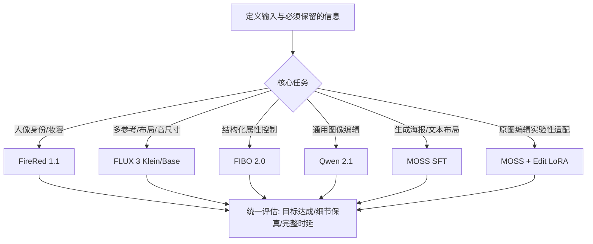
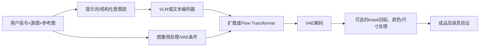

# 五种开放权重图像生成与编辑路线：Qwen / FireRed / FLUX / FIBO / MOSS

> **Living survey · v0.1 · 2026-10-24** | T02（影调/颜色/参考编辑）× T03（可信恢复）× T06（Agent/执行器）× X01（效率）
> **证据级别**：模型卡、官方代码与技术报告属于能力/实现依据；社区案例属于失败模式线索；本报告**未对五模型进行统一复现实验**。功能入口不代表稳定完成率。许可与下载参数以所用 checkpoint 原始文件为准。
>
> **主题导航**：[快速回忆](#快速回忆) · [选型表](#按任务选模型) · [共同架构](#一共同架构从理解到生成) · [逐模型](#二五个模型的机制适用任务与风险) · [公平评估](#三同一任务怎样充分发挥每个模型) · [部署许可](#四部署成本与授权) · [实验模板](#五可复现实验模板) · [References](#references)

## 快速回忆

**主结论**：不要用一个万能 prompt 横评五个生成骨干。先固定**同一用户目标**，再分别采用各模型与 checkpoint 匹配的条件接口、提示编译器和采样日程，并记录端到端成本与保真损失。

| 路线 | 一句话记忆 | 先测什么 | 关键风险 |
|---|---|---|---|
| **Qwen-Image-2.1** | 通用语义编辑、多参考、PE 提示改写 | 常规图像编辑、参考色调、物体替换 | 颜色/细纹理/小字附带漂移；过度“保持”使变化不足 |
| **FireRed-Image-Edit-1.1** | 人物身份、妆容和文字导向的专项训练 | 人像编辑、换装、文字 | 身份保持 ≠ 精确重光照；LoRA 效果需独立记录 |
| **FLUX 3 Image Klein / Base** | 多参考、布局和完整目标场景驱动 | 产品场景、组合参考、高尺寸输出 | PUP 扩写后的目标可能偏离原始编辑需求；布局不是像素锁定 |
| **FIBO 2.0 Dev / Edit Turbo** | VGL 结构化外观目标与图像编辑 | 可审计的属性迁移、产品布景 | 字段未修改 ≠ 输出属性不漂移；mask 条件≠默认像素锁定 |
| **MOSS-Image-SFT + 社区 Edit LoRA** | 基座以文生图/布局为主；编辑为社区扩展 | 文本/布局生成；Edit LoRA 基础编辑探针 | 官方基础生成能力不可外推为原图编辑保真；适配版本敏感 |

> **MOSS 特别说明**：官方 MOSS-Image Base/SFT 的主要定位是文本到图像和布局；输入参考图做编辑主要依赖社区 Edit LoRA（例如 chinoll/Moss-Image-Edit），这不是与其他四款官方编辑模型完全同等成熟度的产品形态。

## 按任务选模型

| 用户需求 | 优先候选（**测试顺序，不是已验证排名**） | 何时改选 |
|---|---|---|
| 源图 A 借鉴参考图 B 的亮度/色彩/影调，不改变结构 | Qwen → FIBO | 如果需要明确审计结构化属性则优先 FIBO；人像密集引入 FireRed |
| 人脸身份保留、换装和妆容 | FireRed → Qwen | 复杂多参考、整体画面合成时加入 FLUX |
| 多参考商品布景、对象位置/比例 | FLUX → Qwen | 文本/版式创作加入 MOSS；结构化属性目标加入 FIBO |
| 文本、海报与精细版式创作 | MOSS（生成）→ FireRed（编辑）→ Qwen | “编辑原有小字且完全不变”必须独立实测，不能以生成文字能力替代 |
| 局部替换且框外像素完全不变 | 任一具备合适目标内容的编辑器 + **输出端 mask 回贴** | prompt、box、mask 条件并不能直接保证框外逐像素一致 |
| 夜景提亮、重模糊复原 | Qwen/FireRed/FIBO/FLUX 均为**待验证候选**；MOSS Edit 为探索组 | 当前没有同设置充分证据确认哪款严重去模糊最强；保真与改善程度双轴评估 |
| 高像素交付 | FLUX（宣称最高 4K）、Qwen（推荐 2K 档）先评估 | **生成尺寸≠真实恢复分辨率**；实际需验证输入编码缩放、输出像素与高频忠实 |

### 模型选择流程



## 一、共同架构：从理解到生成



四个需要分离的概念：

1. **自然语言/结构化意图是否正确**：参考图角色、编辑部位、必须保留的事实是否已经清楚；
2. **生成网络能否完成**：模型对去模糊、重光照、局部替换等不同任务的能力上限；
3. **输出是否保真**：语义相同、几何相同、纹理/文字相同、像素相同是四个不同等级；
4. **完整成本**：提示改写/VLM 编码/采样/VAE/后处理，不等于只测 DiT 耗时。

### 架构与接口快照

| 版本 | 生成骨干及条件方式 | 典型输入接口 | 注 |
|---|---|---|---|
| Qwen-Image-2.1 | 约 7B 单流 Transformer；Qwen3-VL-8B；RGBA VAE | 多图，视觉圈选/涂画/蒙版线索；可选 PE-I2I | 与旧 Qwen-Image 并非同一骨干 |
| FireRed 1.1 | 约 20B 的 Qwen-Image 系路线；Qwen2.5-VL | 1–3 原生参考；多元素 Agent 可裁剪拼合 | 官方人物/文字相关训练和专项 LoRA |
| FLUX 3 Klein | 约 5.6B 生成骨干 + Qwen3-VL-4B；参考图/布局联合条件 | 多参考、box、完整目标 caption；可选独立 PUP | Base 与蒸馏 Klein 采样不同 |
| FIBO 2.0 | 约 8.1B DiT + Qwen3-VL-4B；Perceiver 与多层特征注入 | 自然语言编辑、VGL JSON；底层 Diffusers 支持多图及单图 mask | 内部编码器与外部 VGL 编写器不是同一组件 |
| MOSS SFT / Edit LoRA | MOSS 5B 生成骨干 + Qwen3.5-9B 编码器（依具体版本） | SFT 文生图、JSON layout；Edit LoRA 参考 latent | 社区 Edit 条件格式必须与 LoRA 一致 |

注意：**参数仅为模型组成或官方近似口径，不是整条管线总参数/显存**；部署成本包括所有模型和激活。

## 二、五个模型的机制、适用任务与风险

### 2.1 Qwen-Image-2.1：通用编辑基线

**定位**：复杂语义指令、多图参考、内容替换和外观编辑。推荐用于第一条通用 HarnessIR executor baseline。

**为什么值得测**：多图条件表达空间大；官方 PE-I2I 设计专门关注“变得太少”与“附带改变”的张力。对参考增强可以显式指定源图 A 提供内容、图 B 只提供外观属性。

**限制**：文字、Logo、纹理和几何可能随着局部编辑发生细微漂移；视觉圈选并不保证输出端像素锁定。公开社区案例存在色彩偏移/细小结构变化，但不同量化、VAE、seed 与工作流难以构成独立性能排名。

**推荐流程**：
1. 固定输入序列、尺寸、种子、checkpoint；
2. 从直接指令开始，再运行 PE-I2I 对照，**保存最终改写 prompt**；
3. 标准版以官方常用 40-step 无额外 CFG 路线起步；Turbo 使用对应 8-step 日程；
4. 把“未修改区内容是否忠实”与“目标变化是否足够”分开评估。

**参考风格指令示例**：

```text
Image A is the source and must remain the content and geometry anchor.
Image B is a reference only for tonal appearance.
Transfer B's warmer midtones, softer highlight roll-off and shadow contrast to A.
Keep A's identity, objects, composition, legible text, and scene geometry.
Do not import objects, faces or layout from B.
```

**验证失败类型**：颜色变化外扩、细节重绘、OCR错误、语义理解正确但恢复幅度不足。

### 2.2 FireRed-Image-Edit-1.1：人物/文字专项

**定位**：身份保持、换装、妆容、文字相关编辑。其原有技术报告的训练/奖励设计对身份一致性和 OCR 布局有明确关注；1.0 报告数字不能直接当成 1.1 同条件独立消融。

**优势线索**：人像效果、服饰/妆容和文字编辑有任务针对性；存在专用 LoRA 分支可隔离比较。

**短板**：较重的生成骨干和模型文件；同一人物像不像与精确重光照是两种独立问题。公开 Issue 有身份保持较好、左/右/背光控制仍困难的反馈，不能由一个案例推出普遍胜负。

**推荐流程**：
1. 官方 1.1 基座与所有额外 LoRA 分开记录；
2. 官方常见 40 step、true CFG=4 起步；8-step Lightning 必须匹配适配器；
3. 人像参考增强先固定光照方向，仅调节肤色/局部对比和高光；
4. 改变光源方向必须单列成 relighting，不混为 color/tone transfer。

**参考指令示例**：

```text
Preserve the same person, expression, facial geometry, clothing and background.
Adjust only facial midtone brightness, skin color balance and highlight softness
to match reference B's overall tone. Keep the original lighting direction.
Do not beautify, reshape the face, or replace skin texture.
```

**验证失败类型**：脸型、手部、附加服饰、妆容意外变化，精确光方向未执行。

### 2.3 FLUX 3 Image Klein / Base：目标场景描述、多参考与布局

**定位**：多参考产品合成、物体布局、较大输出画布；并非“只说一句轻微调色便能保证局部不变”。

**核心机制**：官方提示接口强调完整**编辑后目标场景**描述。PUP 为独立提示上采样模型，可根据原图/参考图展开 brief；框用于布局引导，不是硬空间锁定。

**推荐流程**：
1. 先测有无 PUP，再记录 PUP 扩写内容；
2. 主动审查“额外天气/时间/镜头/人物/构图”；
3. 蒸馏 Klein 采用匹配约 16-step 日程；Base 使用对应较长采样（官方工作流常见约 50 steps）；
4. 大尺寸输出报告具体宽高和真实细节，不能仅标注“4K”。

**输入范例**：完整描述最终人物与场景，并写明“source A 的构图/对象不变；只借鉴 reference B 的色调”。检查 PUP 是否把“阴影提亮”扩成“阳光充足的白天”。

**验证失败类型**：参考对象丢失/混淆、box 外重绘、PUP语义漂移、人物/商品细节与原图不符。

### 2.4 FIBO 2.0：VGL 属性语义 + 可审计编辑

**定位**：希望对编辑意图做结构化表达、版本化复用或精细属性检查的场景。

**关键机制**：Diffusers 底层支持自然语言指令；也可将 `edit_instruction` 与结果的结构化 `structured_caption` 输入。VGL 如 `lighting/aesthetics/objects/background` 是可检查语义字段，**不是具有严格独立性保证的控制寄存器**。

**底层 mask 机制提醒**：当前原生 BriaFibo2 图像处理器将白色选区灰化后编码成条件图，底层生成并没有自动把非选区原图像素回贴；若服务层承诺保留，需与服务后处理分开评价。

**推荐流程**：
1. 自然语言直接编辑建第一条 baseline；
2. 结构化 caption+edit_instruction 建第二条；对比目标属性达成和非目标属性漂移；
3. Dev 模型卡推荐 50-step/CFG=5；当前不同管线默认值不完全一样；
4. Edit Turbo 为 4-step/CFG=1，不能假定完整 Dev 的所有用途都同等支持。

**目标结构示例（字段示意，具体遵循所用管线 schema）**：

```json
{
  "structured_caption": {
    "short_description": "The same people, objects and arrangement as source A.",
    "lighting": {"conditions": "gentle highlight roll-off, readable dark midtones"},
    "aesthetics": {"color_palette": "slightly warmer midtones"}
  },
  "edit_instruction": "Use B only as tonal reference; keep A's geometry, people and text."
}
```

**验证失败类型**：仅改 lighting 仍影响肤色/背景；输出被整体重绘；mask 外细节变化。

### 2.5 MOSS-Image SFT + Edit LoRA：官方生成与社区编辑分开

**定位与版本**：
- 官方 **MOSS-Image Base/SFT**：主要是 text-to-image、文字生成、JSON 版面布局，可能结合 depth/color 控制配套适配器；
- **chinoll/Moss-Image-Edit** 社区 LoRA：利用参考 latent 增加编辑能力。**不能拿 SFT 的文生图榜单对它的原图编辑保真背书。**

**重要代码级限制**：ComfyUI 的 `TextEncodeMOSSImageEdit` 支持不同 `edit_format`，如 `ai-toolkit`、`ai-toolkit (kv_cache off)`、`Moss-Image-Edit`。格式决定参考图是否也进入 VLM 以及 reference latents 的布局。错配会导致条件语义与训练方式不一致。

**建议路线**：
1. SFT 用于文本/海报生成时，跟创意生成模型对比；
2. Edit LoRA 先做单参考基础 probe，按该 LoRA 的 Comfy workflow 接线；
3. 以作者常用 30-step、CFG=4、Euler/normal 作为起点，固定图像预缩放/参考尺寸；
4. 再测试轻微调色、替换背景、保真重绘；不要直接将其作为严重复原中的强基线。

**验证失败类型**：条件图与目标对象不一致、参考图不生效、姿态或背景附带变化、文本细节重画。当前公开社区样本稀疏，结论需保持探索性质。

## 三、同一任务怎样充分发挥每个模型

### 贯穿案例 A：A→B 参考影调迁移

**任务契约**：A 是图像事实来源，B 仅定义亮度/颜色/影调；保持人物、可读文字、位置、构图、结构。允许像素值变动，但不允许引入参考图中不属于 A 的对象。

| 执行器 | 原生工作流 | 关键对照 |
|---|---|---|
| Qwen | A+B + 直接指令；再加 PE | PE 改写是否诱发附带修改 |
| FireRed | A+B，锁身份与光方向 | 参考肤色是否迁移，同时不美颜 |
| FLUX | A+B + 完整目标 caption/PUP | 审核扩写后目标是否仍是调色 |
| FIBO | 直接编辑 vs 结构化 VGL | 属性更新是否外溢到其他内容 |
| MOSS Edit | 单图轻编辑 probe；再看参考迁移 | LoRA/格式/参考 latent 是否正确生效 |

**评价**：tone histogram/分区曲线、色彩误差（控制参考配准与差异）、人脸 identity、OCR 精确匹配、边缘/结构匹配、盲评；重点标注未要求改变的区域。

### 贯穿案例 B：夜景低光与严重运动模糊

**任务契约**：允许修正拖影和缺失的模糊边缘，保留可证实对象事实；不许无依据生成车牌、人脸或 Logo。

```text
Restore the horizontal motion blur on the target car.
Improve the recoverable silhouette, wheel outlines and edges.
Preserve object count, car type, viewpoint and relative positions.
Do not invent readable license plates or small logos.
Keep the nighttime atmosphere unless exposure correction is requested.
```

**三类失效**：
- 没恢复：几乎等于输入；
- 好看但不可信：新轮廓、车牌或纹理不是可证实信息；
- 改错场景：夜景变白天、车辆数量/类型改变。

**证据边界**：当前**没有**足以给五者做严肃严重去模糊强弱排名的匹配实验。短提示和低采样次数失败，也不能直接断定骨干绝对无能力；必须比较完整工作流与可复现输入。

### 贯穿案例 C：局部编辑的精确保真

语义未变、几何未变、细节未变、mask 外像素完全未变分级评价。若确需掩码外逐像素一致，输出端可显式混合：

```math
I_{final} = M \odot I_{generated} + (1-M) \odot I_{source}
```

但仅对统一画布与 mask 的非选区强锁定；边界光照、遮挡、内容衔接需另评。

## 四、部署成本与授权

| 模型 | 推理启动口径（具体配置优先） | 注意 |
|---|---|---|
| Qwen 2.1 | 标准常见约 40 steps；Turbo 为专用 8-step 路线 | 图文编码器、可选 PE、量化与 offload 计入时延 |
| FireRed 1.1 | 常见 40-step / true CFG=4；Lightning 8-step LoRA | 20B 骨干更重；LoRA / checkpoint 要精确记录 |
| FLUX 3 Klein | 蒸馏 16-step，Base 较长步数 | PUP 独立成本；4K 要核对具体分辨率 |
| FIBO 2.0 | Dev 推荐 50-step/CFG5；Edit Turbo 4-step/CFG1 | 外部 VGL 编写开销与底层内部 encoder 分离 |
| MOSS Edit | 作者社区流程常见 30-step / CFG4 | 对齐 Edit LoRA 格式与 reference latent pipeline |

**重要：模型文件体积≠推理峰值显存；步数≠端到端延迟。**至少记录 PE/PUP/VGL（如果使用）、VLM、DiT、VAE 的时间/显存。

### 许可证速查（下载时必须重新核对）

- **Qwen-Image-2.1**：Research License；不能仅因代码可读就推断权重可以自由商用。
- **FireRed 1.1**：官方仓库/权重声明 Apache-2.0；专项 LoRA 单独核验。
- **FLUX 3 Klein**：FLUX Kommunity License，有资格和用途限制，尤其需要审查用输出训练其他类似模型的条款。
- **FIBO 2.0**：公开模型卡标示非商业类条款，商业用途需要核实授权；VGL/diffusers 代码许可与权重许可不同。
- **MOSS SFT + 社区 LoRA**：基座、编码器、VAE 和第三方编辑 LoRA 的许可证必须分别核对，不能以“社区开放”概括。

*本节不是法律意见。任何商业部署、输出再训练和伪 GT/蒸馏必须回到逐 checkpoint 的完整 LICENSE。*

## 五、可复现实验模板

**最低实验单元**：输入 A/B 文件 SHA256、模型/adapter SHA、版本、缩放策略、PE/PUP/VGL 最终 prompt、步数、scheduler、CFG、seed、输出长宽、生成耗时、完整耗时、显存、失败标签。

| 实验臂 | 意义 |
|---|---|
| Direct instruction | 基础自然语言对照 |
| Native optimized workflow | 各模型按自身接口充分发挥的结果 |
| Native workflow without planner | 去掉 PE/PUP/VGL 判断是否真的改善 |
| Best-of-N（N 固定） | 防止某个模型只因为多次采样更优秀 |
| Color / geometry / OCR / identity checks | 验证好看的同时是否忠实 |
| Human blinded rating | 人评画质、目标一致与事实保持分别打分 |

**报告最少分四张结果表**：任务达成、事实保真、主观画质、算力和异常；统计按图片配对，用 bootstrap 置信区间，不依据单张范例判断趋势。

**固定分层**：人像/非人像、带文字/不带文字、平滑背景/高纹理、夜景极暗/常规弱光、轻度模糊/严重轨迹拖影、单参考/多参考；每层样本数需预先声明。

**防止误判**：
- 不使用未对齐的尺寸计算像素保真；
- 不以未检查的 prompt 扩写替代用户原需求；
- 不以发布方精选样图视为统计成绩；
- 不以 NR-IQA 的自然程度宣称真实高频恢复；
- 不以生成最高像素数证明原生 4K 真实编辑；
- 不将 MOSS 官方生成分数外推到社区 Edit LoRA。

## 研究结论及待证伪命题

**事实**：五条路线拥有显著不同的输入接口、规划层、采样与许可限制；MOSS 是官方生成加社区编辑的组合。

**推断**：在参考影调任务中，清晰指定参考图角色、保存最终目标描述，有望降低跨场景迁移的语义干扰；但纯 prompt 改善可能无法突破模型的高频保真和去模糊能力上限。

**最小可证伪实验**：每模型 20–50 组同图同目标，原生匹配推理 + planner 消融，记录目标达成与事实保持；若 planner 改善只提高好看程度、并未减小属性外溢，则“结构化描述提升可控性”的普遍判断应被拒绝或收窄。

## References

### 官方模型 / 代码 / 技术报告
1. [Qwen-Image-2.1 model card](https://huggingface.co/Qwen/Qwen-Image-2.1)
2. [Qwen-Image-2.1 GitHub](https://github.com/QwenLM/Qwen-Image-2.1)
3. [Qwen 2.1 PE-I2I system prompt](https://huggingface.co/Qwen/Qwen-Image-2.1-PE-I2I/blob/main/system_prompt.txt)
4. [Qwen-Image-2.1-Turbo](https://huggingface.co/Qwen/Qwen-Image-2.1-Turbo)
5. [FireRed-Image-Edit repository](https://github.com/FireRedTeam/FireRed-Image-Edit)
6. [FireRed 1.1 checkpoint](https://huggingface.co/FireRedTeam/FireRed-Image-Edit-1.1)
7. [FireRed technical report](https://arxiv.org/abs/2602.13344)
8. [FLUX 3 Klein model card](https://huggingface.co/black-forest-labs/flux-3-image-klein)
9. [FLUX 3 Klein PUP](https://huggingface.co/black-forest-labs/flux-3-image-klein-pup)
10. [FLUX 3 official documentation](https://docs.bfl.ai/flux_3/flux3_image_klein)
11. [FLUX 3 Klein release](https://bfl.ai/blog/flux-3-image-klein)
12. [FIBO 2.0 Dev model card](https://huggingface.co/briaai/Fibo-2.0-dev)
13. [FIBO Edit Turbo](https://huggingface.co/briaai/Fibo-2.0-edit-turbo)
14. [FIBO Diffusers pipeline documentation](https://huggingface.co/docs/diffusers/main/api/pipelines/bria_fibo2)
15. [FIBO Diffusers pipeline code](https://github.com/huggingface/diffusers/blob/main/src/diffusers/pipelines/bria_fibo2/pipeline_bria_fibo2.py)
16. [Bria VGL repository](https://github.com/Bria-AI/vgl)
17. [MOSS-Image project](https://github.com/OpenMOSS/MOSS-Image)
18. [MOSS ComfyUI node implementation](https://github.com/Comfy-Org/ComfyUI/blob/master/comfy_extras/nodes_moss_image.py)
19. [MOSS community edit adapter / checkpoints](https://huggingface.co/chinoll/Moss-Image-Edit)

### 独立观察和失败案例（不能当成统一排行榜）
20. [Artificial Analysis image editing leaderboard](https://artificialanalysis.ai/image/leaderboard/editing/open-weights)
21. [FireRed relighting control discussion](https://github.com/FireRedTeam/FireRed-Image-Edit/issues/54)
22. [Qwen product-edit community examples](https://www.reddit.com/r/StableDiffusion/comments/1wokni7/qwen_image_21_is_an_editing_beast/)
23. [Qwen photo-restoration community test](https://www.reddit.com/r/StableDiffusion/comments/1wlifs3/i_tested_qwen_image_21_for_image_restoration_and/)
24. [FIBO community editing test](https://www.reddit.com/r/StableDiffusion/comments/1xbfjik/thoughts_on_fibo_20_image_editing/)
25. [FLUX 3 ComfyUI launch workflow correction](https://www.reddit.com/r/comfyui/comments/1x8qn3d/flux_3_image_klein_our_launchday_example/)

## 与研究库其他专题的关系

- [T02：影调、颜色与参考](../LITERATURE_MAP.md#t02)
- [T03：可信恢复](../LITERATURE_MAP.md#t03)
- [T06：Agent / 动作闭环](../LITERATURE_MAP.md#t06)
- [高效生成式恢复](efficient-generative-restoration.md)
- [一步免反演编辑](one-step-inversion-free-editing.md)

**维护范围**：此文件是跨模型技术对照，不是单篇 paper card；性能变化应记录 checkpoint 日期与证据等级，只有独立横向证据充分时才更新“路线趋势”。
